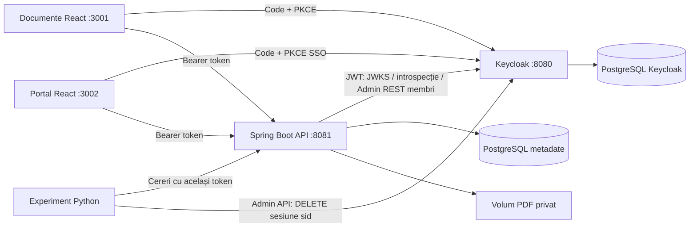

# Arhitectura SecureSync

SecureSync gestionează documente PDF într-un domeniu propriu: identități, departamente și drepturi de acces. Keycloak este singura sursă de autentificare. Nu există registru local de parole sau endpoint de login în API.

Diagrama UML de componente are sursa editabilă în [components.puml](components.puml). Mai jos este aceeași structură în Mermaid, pentru vizualizare în cititoare Markdown compatibile.

## Componente și contracte

API-ul folosește Java 21 și Spring Boot 3.5.8. Codul este organizat pe funcționalități în `ro.securesync.api`: `security`, `documents`, `common`. Spring Security validează identitatea și transformă claim-urile în autorități. Controllerul cere scope și rol înainte de accesul la serviciu; politica documentului verifică proprietarul/departamentul.

Pachetul `members` și tabul Administrare membri din Portal permit rolului IMPLEMENTATOR gestionarea accesului conturilor existente prin Keycloak Admin REST. Un client tehnic separat păstrează secretul pe server. API-ul cere members:manage și IMPLEMENTATOR, apoi verifică online rolul efectiv al solicitantului. Nu se adaugă o tabelă locală de utilizatori și nu se schimbă politica documentelor sau experimentul de revocare. Detalii în [members.md](members.md).

PostgreSQL 16 păstrează numai metadatele documentelor: id, titlu, nume original, cheie internă, proprietar OIDC `sub`, department, dimensiune și data creării. Flyway creează schema, Hibernate o validează. PDF-urile sunt într-un volum separat, accesibil numai API-ului. Cheia internă generată nu este o adresă publică.

Interfețele folosesc React și oidc-client-ts, cu două bundle-uri și clienți OIDC diferiți. Access tokenul și ID tokenul sunt în memoria paginii; sessionStorage păstrează numai tranzacția PKCE. Sesiunea Keycloak permite SSO prin redirect între aplicații.

## Cele două strategii

În profilul `jwt`, API-ul verifică semnătura prin JWKS, issuer-ul, audiența și timpul de validitate. Nu verifică sesiunea online pentru fiecare cerere. Toleranța la expirare este zero pentru măsurarea ferestrei de revocare.

În profilul `introspection`, fiecare cerere autentificată consultă Keycloak prin clientul confidențial al API-ului. Răspunsul trebuie să indice token activ și claim-uri valide pentru issuer, audiență și expirare. Nu există cache de introspecție. Politica de documente rămâne aceeași.

Închiderea sesiunii și schimbarea rolurilor sunt evenimente diferite. Experimentul implementat revocă sesiunea identificată prin `sid` și continuă să folosească tokenul deja emis, fără refresh.

## Consistența fișierelor

Uploadul validează limita de 10 MiB, MIME-ul și antetul PDF înainte de salvare. Un rollback al bazei de date șterge noul fișier. Ștergerea metadatelor se confirmă înainte de eliminarea fișierului. O eroare de filesystem după commit poate lăsa un fișier privat orfan; nu se promite o tranzacție atomică între PostgreSQL și filesystem.

Validarea MIME/antet nu este antivirus sau analiză completă a structurii PDF. Descărcările sunt atașamente prin API și au protecție nosniff. Numele generate, verificarea căii și refuzul symlink-urilor împiedică citirea fișierelor din afara rădăcinii configurate.
